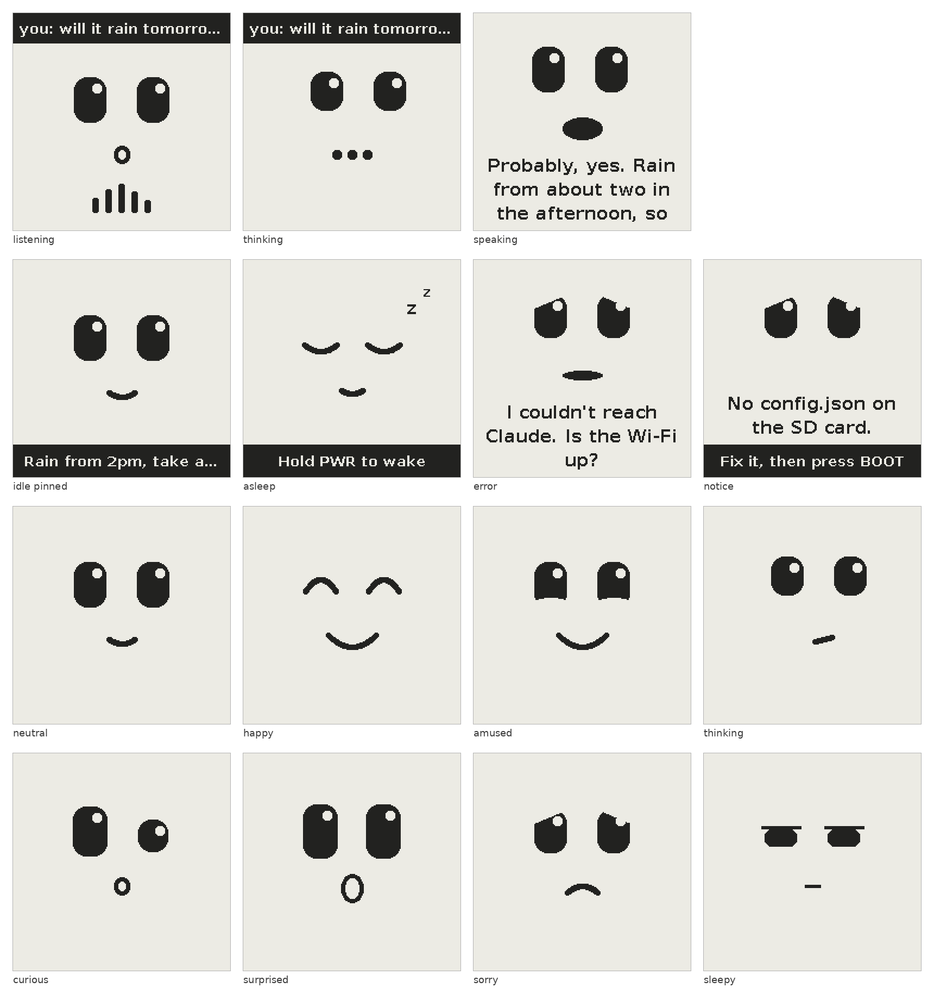

# E-ink Claude assistant (Waveshare ESP32-S3-ePaper-1.54 V2)

A fully standalone home assistant: the board talks straight to Claude's API over
Wi-Fi and shows an expressive 1-bit face with the reply as subtitles over it.
All settings (Wi-Fi, API key, model, display) come from `config.json` on the
microSD card, so one firmware image works for anyone.

This is **milestone 1**: the face, subtitles and a streaming Claude client.
There's no audio yet, so you type questions over USB and the subtitles advance
at speaking pace. Milestones 2 and 3 add voice out and in (see Roadmap).



## Set up

### 1. Prepare the SD card

1. Format a microSD card as **FAT32**.
2. Copy `sdcard/config.json` to the root of the card.
3. Edit it: put in your Wi-Fi name and password and your Anthropic API key (see
   the field reference below).
4. Put the card in the board.

On Windows, make sure the file is really called `config.json` and not
`config.json.txt` (the firmware accepts both, but other tools may not).

### 2. Get the firmware image

**From GitHub (no tools needed).** Push this folder to a GitHub repository; the
included workflow (`.github/workflows/build.yml`) builds it with ESP-IDF 5.5.6.

1. Open **Actions → Build firmware → the latest run**.
2. Download **eink-assistant-firmware** under Artifacts.
3. Unzip it to get `eink_assistant-merged.bin`, a single image that goes at
   address 0x0.

The image holds no secrets, so the repository can be public.

**Or build it yourself** with ESP-IDF 5.5:

```sh
idf.py set-target esp32s3
idf.py build merge-bin -o eink_assistant-merged.bin   # image lands in build/
```

### 3. Flash it from the browser

1. Plug the board into your computer by USB.
2. Open https://espressif.github.io/esptool-js/ in Chrome or Edge.
3. Click **Connect** and pick the board's USB serial port. If no port appears,
   hold BOOT while plugging the board in.
4. Under Program, set the flash address to **0x0**, choose
   `eink_assistant-merged.bin`, and click **Program**.
5. When it finishes, press PWR or replug the board.

From a command line instead:

```sh
esptool.py --chip esp32s3 write_flash 0x0 eink_assistant-merged.bin
```

To watch the logs and type questions, open any serial monitor at 115200 baud on
the board's USB port, or run `idf.py monitor`. Type a question and press Enter.

## config.json reference

| Field | Required | Default | Meaning |
| --- | --- | --- | --- |
| `wifi.ssid` | yes | | Your network's name |
| `wifi.password` | | `""` | Network password; leave empty for an open network |
| `claude.api_key` | yes | | Your Anthropic API key from the Claude Console |
| `claude.model` | | `claude-haiku-5-5` | Haiku is fastest; `claude-sonnet-5-5` is smarter but slower |
| `claude.max_tokens` | | `300` | Longest reply (16 to 8192) |
| `claude.web_search` | | `false` | Let Claude search the web for current information; each search is billed |
| `claude.context` | | `""` | Up to 1000 characters about your home, added to Claude's instructions |
| `elevenlabs.api_key`, `elevenlabs.voice_id` | | `""` | Voice in and out, used from milestone 2 |
| `display.rotation` | | `0` | Quarter turns (0 to 3) if the face is sideways or upside down |
| `display.busy_active_high` | | `true` | Set to `false` if the log shows a busy timeout on every refresh |
| `speech.pace_chars_per_sec` | | `15` | How fast subtitles advance while there's no audio (5 to 40) |

A `claude.context` example: `"Our cat is called Biscuit. Use metric units. The kids are 7 and 10."`

Unknown fields are ignored, and `//` or `/* */` comments are tolerated. After a
successful read, the board keeps a copy of the settings in its own flash, so it
still starts if you take the card out. Editing `config.json` and restarting
always takes priority over that copy.

### When something's wrong

The face shows a sorry expression, the problem in a sentence, and *Fix it, then
press BOOT* in the bottom band. BOOT restarts and re-reads the card.

| Message | What to do |
| --- | --- |
| I can't find an SD card. | Reseat the card |
| The SD card needs to be FAT32. | Reformat as FAT32 (exFAT and NTFS aren't supported) |
| No config.json on the SD card. | Copy the file to the root of the card |
| config.json has a mistake on line N. | Usually a missing comma or quote near that line |
| *field* is missing from / empty in config.json. | Fill in that field |
| Replace the example values in config.json. | The sample placeholders are still there |
| No Wi-Fi: check config.json | The board can't join the network; check the name and password |

## Controls

| Input | Action |
| --- | --- |
| BOOT, short | Ask a demo question (becomes push-to-talk in milestone 3); on a settings problem, restart and re-read the card |
| BOOT, long | Start a new conversation |
| PWR, short | Full refresh to clear ghosting |
| PWR, long | Switch off on battery; the asleep face stays on screen |

Console commands:
- `/face <name>` and `/mode <idle|listening|thinking|speaking|asleep|notice>` show a face state
- `/pin <text>` puts text in the bottom band
- `/full` forces a full refresh
- `/forget` starts a new conversation
- `/battery` prints the battery voltage
- `/reload` restarts and re-reads `config.json`
- `/forget-settings` deletes the copy of the settings saved in flash

## What works now

- Settings from `config.json` on the SD card, checked at start-up, with clear
  on-screen messages when something's wrong and a saved copy in flash.
- Face states: listening, thinking, speaking, idle with the last answer pinned,
  asleep (what the screen keeps while switched off), and a notice screen for
  settings problems.
- Eight expressions Claude picks itself by starting sentences with a cue such as
  `[amused]`; the cue changes the face when that sentence starts.
- Streaming replies: sentences appear while Claude is still writing.
- Subtitles word-wrapped into pages of up to three lines, each with a
  paper-coloured outline so it stays readable over the face, paged in time with
  (for now estimated) speech.
- Partial e-paper refreshes (only changed pixels move), with a full cleaning
  refresh after each reply and every 40 partial updates.
- Battery power latch handled: the board stays on when you let go of PWR, and a
  long press switches it off with the asleep face showing.

## How it fits together

```
config.json ──> config_store ──> settings for Wi-Fi, Claude, display and speaker
console / BOOT ──> assistant ──> claude (HTTPS + SSE) ──> text_stream ──> speaker ──> ui ──> epd
```

| File | Role |
| --- | --- |
| `main/config_store.*` | Mounts the SD card, reads `config.json`, keeps a saved copy in flash |
| `main/core/config_parse.*` | Checks and parses the JSON; unit-tested on the PC |
| `main/board.*` | Pins, power latch, buttons, battery reading |
| `main/epd_ssd1681.*` | Panel driver: full and differential partial refresh, rotation, sleep |
| `main/ui.*` | Screen owner: other tasks change the face state; the UI task redraws |
| `main/claude.*`, `claude_prompt.h` | Streaming client, conversation history, the voice system prompt |
| `main/assistant.*` | Question → thinking face → Claude → speaker |
| `main/speaker_paced.c` | Milestone 1 speaker: paced subtitles and mouth, no audio |
| `main/console.*` | USB line input and test commands |
| `main/core/` | Portable C, also built on your PC for tests: SSE parser, sentence/cue streamer, caption paging and timing, 1-bit graphics, the face, fonts, settings parser |

## Roadmap

1. **Milestone 2, voice out.** Bring up the ES8311 codec (`PIN_AUDIO_PWR` low,
   `PIN_AMP_EN` high) and add `speaker_tts.c` with the same interface as
   `speaker.h`. Each sentence goes to ElevenLabs' stream-with-timestamps endpoint
   as raw PCM. Its per-character start times go into `captions_apply_timing()`.
   The playback clock drives `captions_page_at()` and the audio level drives the
   mouth.
2. **Milestone 3, voice in.** Hold BOOT to talk. Stream 16 kHz PCM to ElevenLabs'
   realtime transcription over a WebSocket, show partial transcripts live in the
   "you:" strip, and send the transcript to Claude on release.
3. **Milestone 4, tools and power.**
   - Claude tools for timers on the PCF85063 RTC, room readings from the SHTC3,
     pinning notes, lists and QR codes, and searching a conversation log on the
     SD card.
   - Deep sleep between conversations, and a wake word when on USB.

## Tests

```sh
make -C test/host test      # 206 unit checks, sanitisers on (includes config.json parsing)
make -C test/host preview   # renders every face state to test/host/build/*.pbm
./test/idf_stub/check.sh    # syntax-checks the firmware without ESP-IDF
```

`tools/make_font.py` regenerates the bitmap fonts at other sizes.
`test/host/third_party/cJSON` is cJSON 1.7.18 (MIT), the same library ESP-IDF
ships as its `json` component; it is only used for the PC tests.

## Notes

- This code hasn't yet been compiled for the board by ESP-IDF; the first real
  build is the GitHub workflow. Every ESP-IDF function and setting it uses has
  been checked against the ESP-IDF 5.5.6 sources, all files compile cleanly
  against stub headers with gcc and clang, and the portable code passes its
  unit tests.
- `config.json` holds your API key in plain text on the card. Keep the card at
  home, and set a monthly spend limit for the key in the Claude Console.
- Fonts are rendered from DejaVu Sans Bold (Bitstream Vera licence with
  public-domain changes).
